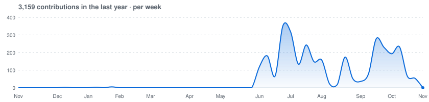

<h1 align="center">Javad Esmaeelpour</h1>

  Structural Engineering Ph.D. · University of Tennessee, Knoxville 
  Reinforced Concrete · Creep & Shrinkage · OpenSees · Nonlinear FEA

  
  

---

  <picture>
    <source media="(prefers-color-scheme: dark)" srcset="assets/activity-dark.svg" />
    
  </picture>

  <picture>
    <source media="(prefers-color-scheme: dark)" srcset="https://streak-stats.demolab.com/?user=Esmaeelpour&hide_border=true&theme=dark&background=0D1117" />
    
  </picture>

## Projects

- [**peerstyle**](https://github.com/Esmaeelpour/peerstyle): publication-quality Matplotlib styling for peer-reviewed journals ([docs](https://esmaeelpour.github.io/peerstyle/))
- [**obsidian-soliddav**](https://github.com/Esmaeelpour/obsidian-soliddav): SolidDAV, reliable WebDAV sync for Obsidian
- [**obsidian-checksorted**](https://github.com/Esmaeelpour/obsidian-checksorted): moves completed to-do items into a separate done area, keeping active tasks clean

## Research software

Structural analysis and design code I work with: [OpenSees](https://github.com/Esmaeelpour/OpenSees), [libdenavit-py](https://github.com/Esmaeelpour/Eslibdenavit-py) and [steeljoist](https://github.com/Esmaeelpour/steeljoist).
